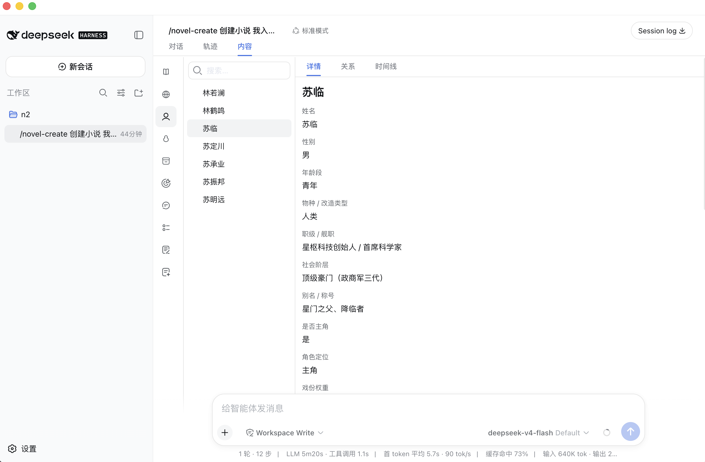

<p align="center">
  
</p>

<p align="center">
  <a href="https://github.com/ddedook/dsh-novel"></a>
  
  
  <a href="LICENSE"></a>
</p>

<h1 align="center">dsh-novel</h1>

<h3 align="center">DeepSeek Harness 的标准小说插件：一个工作区目录就是一本小说。</h3>

在官方 Web UI 的会话里打开 **内容** 页，人物、世界、大纲和章节都落在同一份 canon 里。Agent 通过工具读写，你在侧栏里核对。

## 安装

从 GitHub 装进任意 DSH profile：

```sh
dsh plugin add github:ddedook/dsh-novel
```

Git 安装拉的是源码。pnpm ≥10 第一次可能会拦住安装时构建：按 CLI 提示，把 `dsh-novel` 写进该 profile 的 `pnpm-workspace.yaml`，再重新执行上面的 `add`：

```yaml
allowBuilds:
  dsh-novel: true
```

从 npm：

```sh
dsh plugin add dsh-novel
```

从本地仓库：

```sh
dsh plugin add /path/to/dsh-novel
```

装完后重启 Harness，会话顶部会出现 **内容** 页。

## 一本小说怎么写

1. 左侧打开或新建会话，并绑定一个空目录作为工作区。
2. 对话里输入 `/novel-create`，可选书名和题材（如「玄幻」）。插件会写入 `.dsh-novel`、建 PGlite，并播种模板与技能。
3. Agent 只做开书设定：概述、世界、人物、等级、时间线。**这一步不写大纲和章节。**
4. 设定写完后，用 `/novel-outline` 出大纲，再用 `/novel-chapter` 写正文。
5. 随时切到 **内容** 页查看档案、关系、时间线和章节。

已经是小说工作区时，`/novel-create` 会直接忽略，不会改书名或题材。

## 功能

<table>
  <tr>
    <td width="50%" valign="top">
      <h3>会话「内容」页</h3>
      <p>在对话旁浏览概述、世界树、人物（详情 / 关系 / 时间线）、生物、物品、等级、全书时间线、大纲、章节和技能。字段标签来自题材模板。</p>
    </td>
    <td width="50%" valign="top">
      <h3>一本一库</h3>
      <p>每个工作区目录一份 <code>.dsh-novel/pglite</code>。设定、实体、技能和文风都存在这本书自己的数据库里，换目录就是换书。</p>
    </td>
  </tr>
  <tr>
    <td width="50%" valign="top">
      <h3>写作技能</h3>
      <p>内置开书、人物、世界、大纲、章节和审查技能；Agent 按模块加载。大纲和章节必须由用户显式调用斜杠命令，避免设定阶段提前开写。</p>
    </td>
    <td width="50%" valign="top">
      <h3>题材模板与文风</h3>
      <p>玄幻、仙侠、科幻、都市、言情、历史、悬疑、末世各有一份表单模板。内置文风包括大奉打更人风、黑道邪皇风等，可按书切换。</p>
    </td>
  </tr>
</table>

## 内容分区

| 分区 | 存什么 |
| --- | --- |
| 概述 | 书名、题材、卖点、blueprint |
| 世界 | 世界树（规则、势力、地图、伏笔） |
| 人物 | 档案、关系、人物时间线 |
| 生物 | 异兽与灵植 |
| 物品 | 档案与流转归属 |
| 等级 | 体系、能力与代价 |
| 时间线 | 全书事件轴（含伏笔 / 冲突 / 悬念） |
| 大纲 | 卷章结构 |
| 章节 | 正文 |
| 技能 | 本书自己的写作 / 审查技能行 |

## 斜杠命令与模块技能

| 命令 | 谁能调用 | 做什么 |
| --- | --- | --- |
| `/novel-create` | 用户 / 模型 | 初始化工作区并写开书设定，不写大纲和章节 |
| `/novel-outline` | 用户 | 写大纲 |
| `/novel-chapter` | 用户 | 写章节 |

其余模块技能由模型在需要时加载：`novel-overview`、`novel-world`、`novel-role`、`novel-creature`、`novel-item`、`novel-level`、`novel-timeline`、`novel-review`。

技能正文存在这本书的数据库里，可在 **内容 → 技能** 里改；改的是本书目录，不是插件包里的种子文件。

## Host 工具

Agent 用这些工具读写 canon（工作区路径默认为会话 cwd）：

| 工具 | 作用 |
| --- | --- |
| `novel_status` / `novel_create` | 检查或初始化小说工作区 |
| `get_novel` / `update_novel` | 读、改书名、题材、概述 blueprint |
| `describe_schema` | 列出实体域 |
| `query_entities` / `get_entities` / `mutate_entities` / `delete_entity` | 实体 CRUD |
| `get_template` / `save_template` | 读、换表单模板 |
| `skill_list` / `upsert_skill` / `delete_skill` | 本书技能行 |
| `list_writing_styles` | 列出可用文风 |

实体域包括 `role`、`roleRelation`、`roleTimeline`、`world`、`creature`、`item`、`level`、`timeline`、`outline`、`chapter` 等。写入时字段用模板的顶层 key，不要包进 `profile`。

Web 客户端走同源 JSON API：`/dsh-novel/api`。

## 开发

```sh
corepack pnpm install
corepack pnpm check
```

`check` 会构建、类型检查并跑测试。插件入口是 Host 的 `src/index.ts` 和客户端的 `src/client/index.ts`；种子模板和技能在 `seed/`。

```sh
corepack pnpm test
corepack pnpm build
```

## License

本项目遵循 [MIT License](LICENSE)。

本项目是基于 [DeepSeek Harness](https://github.com/deepseek-ai/deepseek-harness) 构建的社区插件，并非 DeepSeek 官方产品。

本项目完全开源免费。如果有人向您以任何形式出售此软件，请拒绝交易。

DeepSeek 是 DeepSeek AI 的商标。dsh-novel 是独立的社区项目，与 DeepSeek 官方没有隶属关系，也未获得其背书。
